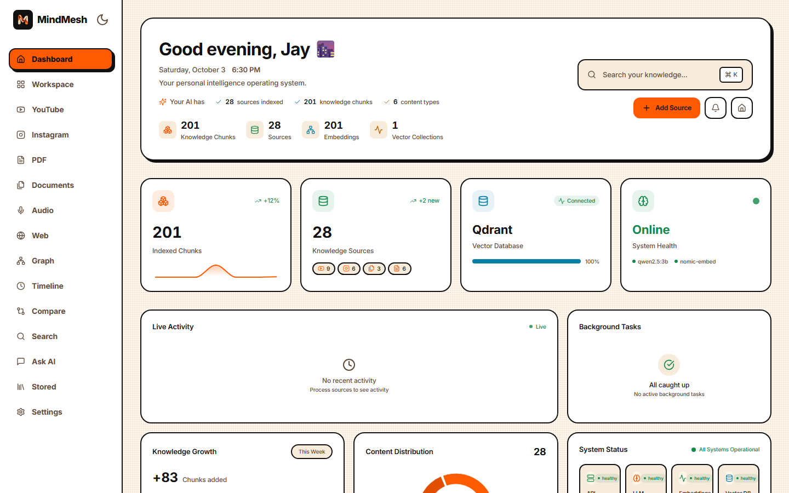
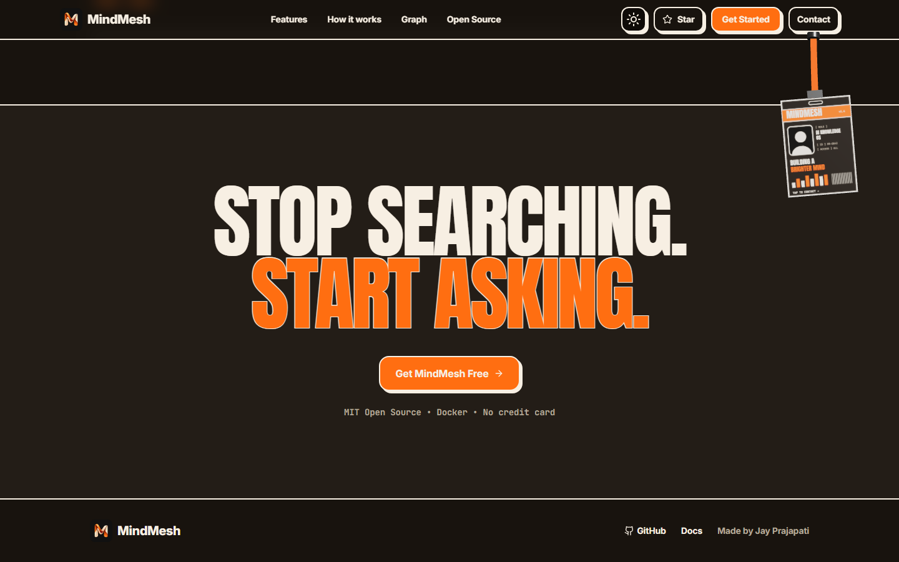
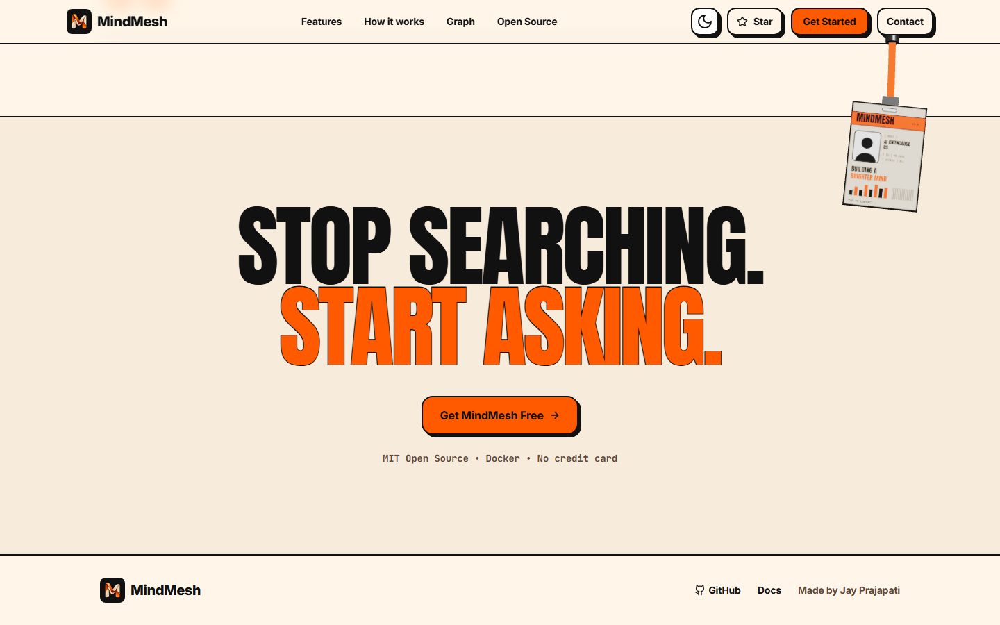
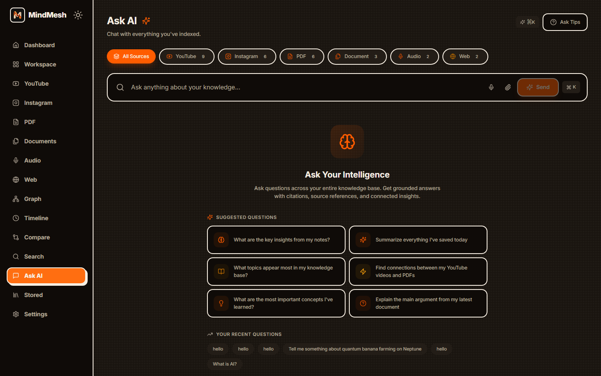
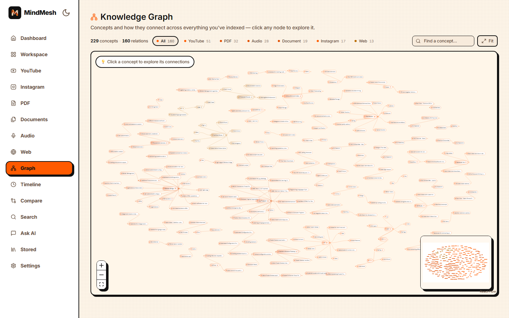

<div align="center">


# **MindMesh**

### *Your buddy who remembers everything you save*

**Capture → Understand → Connect → Ask.**  
Stop remembering *where* you saw something — just ask MindMesh naturally.


<br/>



<br/>

**[Quick Start](#-quick-start) · [Features](#-features) · [Architecture](#-architecture) · [API](#-api-overview) · [QA Report](docs/QA_REPORT.md)**

</div>

---

<div align="center">

> ### 🧩 *“Everything you watch, read, hear and save, unified into one brain you can talk to.”*

</div>

---

## 📑 Table of Contents

<details>
<summary><b>Click to expand</b></summary>

1. [✨ Why MindMesh](#-why-mindmesh)
2. [🎯 Features](#-features)
3. [🖼️ Screenshots](#️-screenshots)
4. [🏗 Architecture](#-architecture)
5. [🧰 Tech Stack](#-tech-stack)
6. [🤖 AI Backend Selection](#-ai-backend-selection)
7. [🚀 Quick Start](#-quick-start)
8. [🛠️ Deployment](#️-deployment)
9. [🧪 Development & Testing](#-development--testing)
10. [📦 API Overview](#-api-overview)
11. [🗂 Repository Structure](#-repository-structure)
12. [⚙️ Configuration](#-configuration)
13. [📚 Documentation](#-documentation)
14. [🤝 Contributing](#-contributing)
15. [📄 License & Author](#-license--author)

</details>

---

## ✨ Why MindMesh

<table>
<tr>
<td align="center" width="33%">

### 😵 The Problem
YouTube videos, PDFs, reels, articles, lectures, notes — scattered everywhere. Finding that *one thing* you saw last week is impossible.

</td>
<td align="center" width="34%">

### 🧠 The MindMesh Way
Ingest anything — **video, audio, PDF, doc, web, social** — and ask questions in plain English. Answers come back **grounded with citations** from *your* content.

</td>
<td align="center" width="33%">

### 🚀 The Result
A **private, self-hosted second brain**: semantic search, knowledge graphs, timelines, and cross-source comparisons — all running locally with **your** data.

</td>
</tr>
</table>

**🌟 Highlights**

| | |
|---|---|
| 🗣️ **Grounded Ask AI** | Answers only from *your* content — with citations, mic & file uploads |
| 🤖 **Adaptive AI Backend** | Auto-selects **Groq Cloud → Hugging Face Spaces → local** — works with *or* without API keys |
| 🕸️ **Hybrid RAG** | Dense + sparse + graph retrieval fused with **RRF** |
| 🧠 **GraphRAG** | Entity/relation extraction → knowledge graph → community summaries |
| ⚡ **Streaming UX** | SSE live ingestion progress + token-streamed chat |
| 🛡️ **Type-safe** | End-to-end **TypeScript** + **Pydantic v2** validation |
| 🧩 **Extensible** | Plugin-style ingestion pipelines |
| 🏭 **Production-ready** | Docker, health checks, structured logging, rate limits, CI/CD |

---

## 🎯 Features

<table>
<tr>
<td width="50%">

| | Feature | What it does |
|---|---------|--------------|
| 🎥 | **YouTube Intelligence** | Transcribe, summarize, chapterize & chat with any video |
| 📄 | **PDF Intelligence** | Multi-stage pipeline: extract → clean → chunk → embed → graph |
| 🎙️ | **Audio Intelligence** | Whisper transcription + speaker diarization + summarization |
| 📸 | **Instagram Intelligence** | Download posts/reels/stories, captions, OCR, embeddings |
| 🌐 | **Web Intelligence** | Crawl, extract, summarize and index any webpage |
| 📚 | **Document Intelligence** | PDF, DOCX, TXT, MD, EPUB — one universal processor |

</td>
<td width="50%">

| | Feature | What it does |
|---|---------|--------------|
| 🗣️ | **Grounded Ask AI** | Context-only answers with citations — refuses to guess, voice input + file uploads |
| 🕸️ | **Knowledge Graph** | Auto-extracted entities & relations, interactive React Flow viz |
| ⏰ | **Memory Timeline** | Chronological view of everything you've ingested |
| 🔀 | **Cross-Source Intel** | Compare, contrast & synthesize across multiple sources |
| 🤖 | **AI Workspace** | Persistent threads, follow-ups, source filters |
| 🧩 | **Browser Extension** | MV3 one-click clipper for instant capture |
| 🔔 | **Real-time Processing** | SSE live pipeline updates with progress tracking |
| 🌓 | **Light & Dark** | One-click theme toggle across the whole app |

</td>
</tr>
</table>

---

## 🖼️ Screenshots

| 🌙 Landing — Dark | 💡 Landing — Light |
|---|---|
|  |  |
| 💬 Ask AI — Dark | 🕸️ Knowledge Graph |
|  |  |

---

## 🏗 Architecture

```
┌─────────────┐     ┌─────────────┐     ┌───────────────────────────────────────┐
│  Frontend   │────▶│   Backend   │────▶│  AI backend (auto-selected at boot)   │
│  (Next.js)  │     │  (FastAPI)  │     │  1. Groq Cloud   — GPU, free tier     │
└─────────────┘     └──────┬──────┘     │  2. HF Spaces    — CPU, free tier     │
                           │            │  3. Local        — Ollama / workers   │
                           │            └───────────────────────────────────────┘
              ┌────────────┼────────────┐
              ▼            ▼            ▼
         ┌─────────┐ ┌──────────┐ ┌───────────┐
         │  Qdrant │ │PostgreSQL│ │   Redis   │
         │(Vectors)│ │(Relational)│ │(Cache/Queue)│
         └─────────┘ └──────────┘ └───────────┘
```

**Ingestion pipelines:** `🎥 YouTube · 📄 PDF · 🎙️ Audio · 📸 Instagram · 🌐 Web · 📚 Documents`  
→ chunk → embed → index → graph-extract → **ask anything**.

**Heavy jobs** (YouTube / PDF / audio) can run in-process (local Docker) or on
**Modal serverless workers** backed by **Supabase** (Postgres · Auth · Storage) —
selected via `MINDMESH_EXECUTION_MODE=local|modal`.

---

## 🧰 Tech Stack

| Layer | 🛠 Technology |
|-------|--------------|
| **Frontend** | Next.js 15, TypeScript, Tailwind CSS, React Query, Zustand, Axios, React Flow, Framer Motion, Lenis, Three.js |
| **Backend** | FastAPI, Python 3.11+, AsyncIO, Pydantic v2 |
| **AI / ML** | Groq Cloud (Llama 3.1 8B Instant), Hugging Face Spaces (BART, CPU), Ollama (Qwen2.5 / Qwen3), nomic-embed-text / BGE-M3, Faster-Whisper, yt-dlp, Docling + Tesseract OCR |
| **Vector DB** | Qdrant (HNSW, payload filtering) |
| **Relational DB** | PostgreSQL (asyncpg, SQLAlchemy 2.0) |
| **Cache / Queue** | Redis (BullMQ-style) |
| **Cloud services** | Supabase (contact form, cloud auth, storage, SQL migrations), Modal (serverless AI workers) |
| **Infra** | Docker, Docker Compose, Caddy/Nginx, GitLab CI/CD, Hugging Face Spaces |
| **Extension** | Manifest V3, TypeScript, Webpack |

---

## 🤖 AI Backend Selection

MindMesh picks an LLM backend **at startup** — no code changes needed, just set
an environment variable:

| Priority | Backend | Trigger | Notes |
|----------|---------|---------|-------|
| 1️⃣ | **Groq Cloud** | `GROQ_API_KEY` set | GPU-accelerated, OpenAI-compatible API. Free tier: **30 RPM · 30K TPM · 500K TPD** (8B models), Whisper 2,000 RPD |
| 2️⃣ | **Hugging Face Spaces** | `HF_SPACE_URL` set | Your own free CPU Space runs the worker (`deploy/hf-spaces/`) |
| 3️⃣ | **Local** (default) | neither set | Ollama (Qwen) + local `transformers` / `yt-dlp` / Docling — fully offline, private |

```bash
# Fastest — Groq free tier
export GROQ_API_KEY="gsk_..."           # optional: GROQ_MODEL=llama-3.1-8b-instant

# Free CPU worker on Hugging Face
export HF_SPACE_URL="https://your-space.hf.space"

# No keys at all → everything runs locally (default)
```

- Selection lives in [`backend/app/core/backend_config.py`](backend/app/core/backend_config.py)
  and is logged on boot: `Active AI backend: groq (...)` (secrets never logged).
- Chat + streaming route through [`backend/app/services/llm.py`](backend/app/services/llm.py);
  answers stay grounded in *your* content regardless of backend.
- Your own Space as a worker: see [`deploy/hf-spaces/`](deploy/hf-spaces/)
  (Docker Space, port 7860, `yt-dlp` + `facebook/bart-large-cnn` summarizer).

---

## 🚀 Quick Start

### ✅ Prerequisites
- 🐳 **Docker Desktop** (≥ 8 GB RAM allocated)
- 📦 **Git**

### 🪟 Windows (PowerShell)

```powershell
git clone https://github.com/Jay-Prajapati01/MindMesh.git
cd MindMesh
copy backend\.env.example backend\.env
docker compose up --build
```

### 🍎 macOS / 🐧 Linux

```bash
git clone https://github.com/Jay-Prajapati01/MindMesh.git
cd MindMesh
cp backend/.env.example backend/.env
docker compose up --build
```

### 🤖 First Run — Pull AI Models

```bash
# Default (16 GB RAM, CPU-friendly)
docker compose exec ollama ollama pull qwen2.5:3b
docker compose exec ollama ollama pull nomic-embed-text

# High-end / GPU (edit backend/.env first)
docker compose exec ollama ollama pull qwen3:8b
docker compose exec ollama ollama pull bge-m3
```

> 💡 **No GPU / no models?** Add `GROQ_API_KEY=...` to `backend/.env` and the
> backend switches to Groq Cloud for chat — see [AI Backend Selection](#-ai-backend-selection).

### 🌐 Access Points

| Service | URL |
|---------|-----|
| 🎛️ Frontend Dashboard | http://localhost:3000 |
| 📚 API Docs (Swagger) | http://localhost:8000/docs |
| 🔍 Qdrant Dashboard | http://localhost:6333/dashboard |
| 📊 Grafana *(if enabled)* | http://localhost:3001 |

---

## 🛠️ Deployment

Four supported deployment targets — pick what fits:

| Target | Command / Guide | Use for |
|--------|-----------------|---------|
| 🐳 **Local dev** | `docker compose up --build` (root) or `docker compose -f deploy/docker-compose.dev.yml up` | Daily development |
| ☁️ **Cloud production** | [`DEPLOYMENT.md`](DEPLOYMENT.md) — Caddy + TLS on a VM | Public self-hosted instance |
| 🧠 **Serverless AI workers** | [`docs/MODAL_DEPLOYMENT.md`](docs/MODAL_DEPLOYMENT.md) + [`deploy/docker-compose.cloud.yml`](deploy/docker-compose.cloud.yml) | YouTube/PDF/audio jobs on Modal + Supabase |
| 🤗 **HF Space worker** | [`deploy/hf-spaces/`](deploy/hf-spaces/) — `python deploy/hf-spaces/deploy_hf.py` | Free CPU AI worker (summarization) |

> Production configs live in [`deploy/`](deploy/) (`docker-compose.prod.yml`,
> `Caddyfile`, `.env.production.example`). Production mode requires
> `MINDMESH_EXECUTION_MODE=modal` (see [`docs/MODAL_DEPLOYMENT.md`](docs/MODAL_DEPLOYMENT.md)).

---

## 🧪 Development & Testing

<details>
<summary><b>🖥️ Frontend only (with mock data)</b></summary>

```bash
cd frontend
npm install
npm run dev
# Opens http://localhost:3000
```

</details>

<details>
<summary><b>Full regression suite</b></summary>

```powershell
# Backend unit and API tests
cd backend
python -m pytest -q

# Lint (backend)
python -m ruff check app tests

# Frontend type-check + lint + build
cd frontend
npx tsc --noEmit
npm run lint
npm run build

# Everything: pytest + API / contract / schema checks
powershell -File scripts\qa\run_all.ps1
```

</details>

The GitHub Actions workflow runs backend tests and lint checks, plus frontend
type-checking, linting, and a production build for pushes and pull requests.
See [docs/QA_REPORT.md](docs/QA_REPORT.md) for the maintained QA overview.

---

## 📦 API Overview

| Module | Endpoints |
|--------|-----------|
| 💬 **Chat** | `POST /api/chat`, `GET /api/chat/history` |
| 🎥 **YouTube** | `POST /api/youtube/ingest`, `GET /api/youtube/{id}` |
| 📄 **PDF** | `POST /api/pdf/ingest`, `POST /api/pdf/batch` |
| 📸 **Instagram** | `POST /api/instagram/ingest` |
| 📚 **Documents** | `POST /api/documents/ingest` |
| 🎙️ **Audio** | `POST /api/audio/ingest` |
| 🌐 **Web** | `POST /api/web/ingest` |
| 🔍 **Search** | `POST /api/search`, `POST /api/search/hybrid` |
| 🕸️ **Graph** | `GET /api/graph`, `GET /api/graph/nodes/{id}` |
| ⏰ **Timeline** | `GET /api/timeline` |
| 📊 **Stats** | `GET /api/stats` |

> 📖 Interactive docs: **http://localhost:8000/docs**

---

## 🗂 Repository Structure

```
MindMesh/
├── backend/              ⚙️  FastAPI service
│   ├── app/
│   │   ├── api/          REST endpoints (15+ routers, incl. cloud jobs)
│   │   ├── core/         Config, logging, security, ratelimit, backend_config
│   │   ├── models/       Pydantic schemas
│   │   └── services/     Business logic (RAG, Graph, Ingestion, Jobs, LLM)
│   ├── tests/            Pytest suite
│   └── requirements.txt
├── frontend/             🎨 Next.js 15 Dashboard
│   ├── app/              App Router pages
│   ├── components/       60+ reusable components
│   ├── hooks/            Custom React hooks
│   └── lib/              API client, auth, utilities
├── extension/            🧩 MV3 Browser Extension
├── workers/              🧠 Modal serverless AI workers
├── supabase/migrations/  🗄️  SQL migrations (cloud workers, normalized state)
├── deploy/               🚀 Deployment configs (dev/prod/cloud + hf-spaces/)
│   └── hf-spaces/        🤗 Hugging Face Space worker (Docker, port 7860)
├── scripts/              🛠️  ops scripts (purge_tenant.py, migrate_cloud.py, qa/)
├── docs/                 📚 Architecture, security, runbooks, QA, screenshots
├── docker-compose.yml    🐳 Full stack orchestration
├── .github/workflows/    GitHub Actions checks
└── .gitlab-ci.yml        GitLab CI pipeline
```

---

## ⚙️ Configuration

Edit **`backend/.env`**:

| Category | Variables |
|----------|-----------|
| 🤖 AI backend | `GROQ_API_KEY`, `GROQ_MODEL` (default `llama-3.1-8b-instant`), `HF_SPACE_URL` — see [AI Backend Selection](#-ai-backend-selection) |
| 🤖 Models | `OLLAMA_MODEL`, `EMBEDDING_MODEL` |
| 🧠 Execution mode | `MINDMESH_EXECUTION_MODE` (`local` default / `modal` required in production) |
| ✂️ Chunking | `CHUNK_SIZE`, `CHUNK_OVERLAP` |
| 🕸️ Graph | `ENTITY_EXTRACTION_ENABLED`, `RELATION_EXTRACTION_ENABLED` |
| 🗣️ Chat grounding | `CHAT_MIN_SCORE` (minimum retrieval score before answering) |
| 🌐 Frontend | `NEXT_PUBLIC_API_URL`, `NEXT_PUBLIC_SUPABASE_URL`, `NEXT_PUBLIC_SUPABASE_PUBLISHABLE_KEY` |
| 🔑 API Keys | YouTube, Instagram, etc. |
| 🔒 Security | `SSRF_BLOCK_PRIVATE`, `MAX_JSON_BODY_SIZE`, `MAX_MULTIPART_BODY_SIZE`, `RATE_LIMIT_ENABLED`, `RATE_LIMIT_MAX_REQUESTS`, `RATE_LIMIT_WINDOW`, `TRUST_PROXY`, `MAX_CONCURRENT_HEAVY_TASKS`, `MAX_PDF_PAGES`, `ZIP_MAX_UNCOMPRESSED_BYTES`, `ZIP_MAX_RATIO`, `FETCH_MAX_BYTES`, `FETCH_TIMEOUT_SECONDS` |

> 🧪 Env templates: [`backend/.env.example`](backend/.env.example),
> [`deploy/.env.production.example`](deploy/.env.production.example),
> [`deploy/cloud.env.example`](deploy/cloud.env.example)

---

## 📚 Documentation

| 📄 Document | Description |
|-------------|-------------|
| [SETUP_GUIDE.md](docs/SETUP_GUIDE.md) | Installation, configuration, first run |
| [MINDMESH_ARCHITECTURE_PLAN.md](docs/MINDMESH_ARCHITECTURE_PLAN.md) | System design, data flow, pipelines |
| [QA_REPORT.md](docs/QA_REPORT.md) | 🧪 Full QA report — journeys, findings, fixes, regression suite |
| [SECURITY_REPORT.md](docs/SECURITY_REPORT.md) | 🔒 Security review — threat model, hardening findings |
| [AUTHORIZATION_MATRIX.md](docs/AUTHORIZATION_MATRIX.md) | 🔑 Roles, scopes & endpoint permissions |
| [RUNBOOKS.md](docs/RUNBOOKS.md) | 🚨 Operational procedures & incident response |
| [SECRET_ROTATION.md](docs/SECRET_ROTATION.md) | 🔁 Key rotation playbook |
| [NORMALIZATION_PLAN.md](docs/NORMALIZATION_PLAN.md) | 🗃️ State normalization cutover (backfill, dual-write, rollback) |
| [MODAL_DEPLOYMENT.md](docs/MODAL_DEPLOYMENT.md) | 🧠 Cloud AI workers on Modal + Supabase |
| [DEPLOYMENT.md](DEPLOYMENT.md) | ☁️ Production VM deployment (Caddy, TLS, backups) |
| [scripts/qa/](scripts/qa/) | Runnable regression checks |

---

## 🤝 Contributing

Contributions are welcome. Read the [contribution guide](CONTRIBUTING.md) before
opening a pull request, and follow the [Code of Conduct](CODE_OF_CONDUCT.md).
Report security issues privately using the process in [SECURITY.md](SECURITY.md).

For bugs and feature requests, use the project's
[GitHub Issues](https://github.com/Jay-Prajapati01/MindMesh/issues).

---

## 📄 License & Author

Released under the [MIT License](LICENSE). ✅

<br>

<div align="center">

**👨‍💻 Jay Prajapati**
[@Jay-Prajapati01](https://github.com/Jay-Prajapati01)

<br/>

⭐ **If MindMesh helps you, consider giving it a star!** ⭐

</div>
