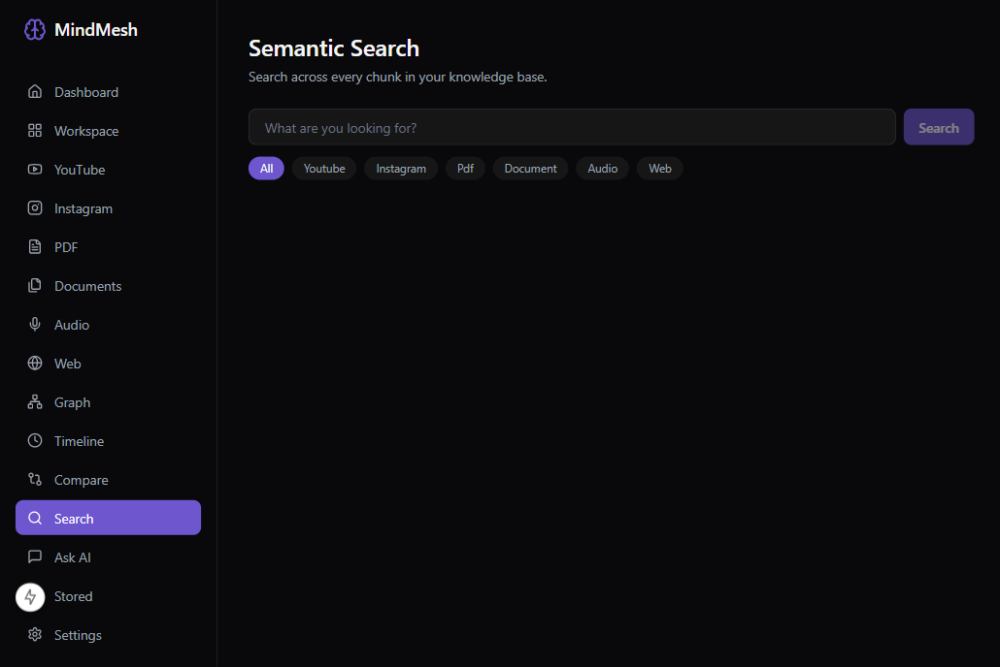

# MindMesh

**AI Personal Knowledge Operating System** — Capture, understand, organize, connect, and retrieve information from everything you consume digitally (YouTube, PDFs, documents, social media, audio, web).

Instead of remembering *where* you saw something, you just ask MindMesh naturally.

---

## 🎬 Demo

| Dashboard | AI Chat | Knowledge Graph |
|-----------|---------|-----------------|
|  | *Chat with your knowledge* | *Visualize connections* |

---

## ✨ Features

| Feature | Description |
|---------|-------------|
| **🎥 YouTube Intelligence** | Transcribe, summarize, chapterize, and chat with any video |
| **📄 PDF Intelligence** | Multi-stage pipeline: extract → clean → chunk → embed → graph |
| **🎙️ Audio Intelligence** | Whisper transcription + speaker diarization + summarization |
| **📸 Instagram Intelligence** | Download posts/reels/stories, extract captions, OCR, embed |
| **🌐 Web Intelligence** | Crawl, extract, summarize, and index any webpage |
| **📚 Document Intelligence** | Universal document processor (PDF, DOCX, TXT, MD, EPUB) |
| **🧠 Unified AI Chat** | RAG + GraphRAG + hybrid search across all your sources |
| **🕸️ Knowledge Graph** | Auto-extracted entities & relationships, interactive React Flow viz |
| **⏰ Memory Timeline** | Chronological view of everything you've ingested |
| **🔀 Cross-Source Intelligence** | Compare, contrast, synthesize across multiple sources |
| **🤖 AI Workspace** | Persistent threads, follow-ups, citations, confidence scoring |
| **🧩 Browser Extension** | MV3 one-click clipper for instant capture |
| **🔔 Real-time Processing** | SSE live pipeline updates with progress tracking |

---

## 🏗 Architecture

```
┌─────────────┐     ┌─────────────┐     ┌─────────────┐
│  Frontend   │────▶│   Backend   │────▶│   Ollama    │
│  (Next.js)  │     │  (FastAPI)  │     │   (LLM)     │
└─────────────┘     └──────┬──────┘     └─────────────┘
                           │
              ┌────────────┼────────────┐
              ▼            ▼            ▼
         ┌─────────┐ ┌──────────┐ ┌───────────┐
         │  Qdrant │ │PostgreSQL│ │   Redis   │
         │(Vectors)│ │ (Relational)│ │(Cache/Queue)│
         └─────────┘ └──────────┘ └───────────┘
```

---

## 🚀 Quick Start

### Prerequisites
- Docker Desktop (with ≥8 GB RAM allocated)
- Git

### Windows (PowerShell / CMD)
```bash
git clone https://github.com/Jay-Prajapati01/MindMesh.git
cd MindMesh
copy backend\.env.example backend\.env
docker compose up --build
```

### macOS / Linux
```bash
git clone https://github.com/Jay-Prajapati01/MindMesh.git
cd MindMesh
cp backend/.env.example backend/.env
docker compose up --build
```

### First Run — Pull AI Models
```bash
# Default (16 GB RAM, CPU-friendly)
docker compose exec ollama ollama pull qwen2.5:3b
docker compose exec ollama ollama pull nomic-embed-text

# High-end / GPU (edit backend/.env first)
docker compose exec ollama ollama pull qwen3:8b
docker compose exec ollama ollama pull bge-m3
```

### Access Points
| Service | URL |
|---------|-----|
| 🎛️ Frontend Dashboard | http://localhost:3000 |
| 📚 API Docs (Swagger) | http://localhost:8000/docs |
| 🔍 Qdrant Dashboard | http://localhost:6333/dashboard |
| 📊 Grafana (if enabled) | http://localhost:3001 |

---

## 🧪 Development (Frontend Only)
```bash
cd frontend
npm install
npm run dev
# Opens http://localhost:3000 with mock data
```

---

## 📁 Repository Structure
```
MindMesh/
├── backend/              # FastAPI service
│   ├── app/
│   │   ├── api/          # REST endpoints (14+ routers)
│   │   ├── core/         # Config, logging, security
│   │   ├── models/       # Pydantic schemas
│   │   └── services/     # Business logic (RAG, Graph, Ingestion)
│   ├── tests/            # Pytest suite
│   └── requirements.txt
├── frontend/             # Next.js 15 Dashboard
│   ├── app/              # App Router pages
│   ├── components/       # 60+ reusable components
│   ├── hooks/            # Custom React hooks
│   └── lib/              # API client, utilities
├── extension/            # MV3 Browser Extension
│   ├── popup.html/js     # One-click capture UI
│   └── manifest.json
├── docker-compose.yml    # Full stack orchestration
├── .gitlab-ci.yml        # CI/CD pipeline
└── MINDMESH_ARCHITECTURE_PLAN.md
```

---

## ⚙️ Configuration

Edit `backend/.env` for:
- **Models**: `OLLAMA_MODEL`, `EMBEDDING_MODEL`
- **Chunking**: `CHUNK_SIZE`, `CHUNK_OVERLAP`
- **Graph**: `ENTITY_EXTRACTION_ENABLED`, `RELATION_EXTRACTION_ENABLED`
- **API Keys**: YouTube, Instagram, etc.

---

## 🧰 Tech Stack

| Layer | Technology |
|-------|------------|
| **Frontend** | Next.js 15, TypeScript, Tailwind CSS, React Query, Zustand, Axios, React Flow |
| **Backend** | FastAPI, Python 3.11+, AsyncIO, Pydantic v2 |
| **AI/ML** | Ollama (Qwen2.5/Qwen3), nomic-embed-text/BGE-M3, Faster-Whisper, yt-dlp |
| **Vector DB** | Qdrant (HNSW, payload filtering) |
| **Relational DB** | PostgreSQL (asyncpg, SQLAlchemy 2.0) |
| **Cache/Queue** | Redis (BullMQ-style) |
| **Infra** | Docker, Docker Compose, Nginx, GitLab CI/CD |
| **Extension** | Manifest V3, TypeScript, Webpack |

---

## 📦 API Overview

| Module | Endpoints |
|--------|-----------|
| **Chat** | `POST /api/chat`, `GET /api/chat/history` |
| **YouTube** | `POST /api/youtube/ingest`, `GET /api/youtube/{id}` |
| **PDF** | `POST /api/pdf/ingest`, `POST /api/pdf/batch` |
| **Instagram** | `POST /api/instagram/ingest` |
| **Documents** | `POST /api/documents/ingest` |
| **Audio** | `POST /api/audio/ingest` |
| **Web** | `POST /api/web/ingest` |
| **Search** | `POST /api/search`, `POST /api/search/hybrid` |
| **Graph** | `GET /api/graph`, `GET /api/graph/nodes/{id}` |
| **Timeline** | `GET /api/timeline` |
| **Stats** | `GET /api/stats` |

Full docs: http://localhost:8000/docs

---

## 🌟 Highlights

- **Hybrid RAG** — Dense + sparse + graph retrieval fused with RRF
- **GraphRAG** — Entity/relation extraction → knowledge graph → community summaries
- **Streaming UX** — SSE for live ingestion progress, token streaming chat
- **Type-safe** — End-to-end TypeScript + Pydantic validation
- **Extensible** — Plugin-style ingestion pipelines
- **Production-ready** — Docker, health checks, structured logging, CI/CD

---

## 📄 License

MIT License — see [LICENSE](LICENSE) for details.

---

## 👨‍💻 Author

**Jay Prajapati**  
GitHub: [@Jay-Prajapati01](https://github.com/Jay-Prajapati01)

---

## ⭐ Star History

If MindMesh helps you, consider giving it a ⭐!