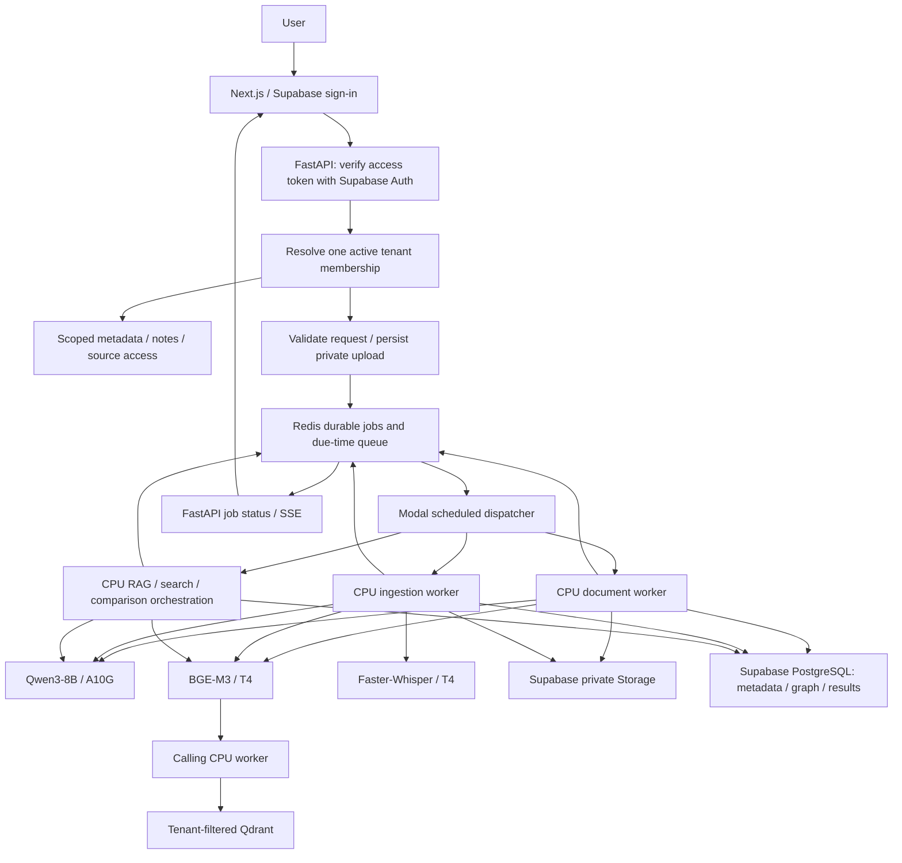

# MindMesh cloud workers — deployment preparation

Implementation date: 6 October 2026. This implementation uses the current checkout at
`J:\Mindmesh by gitlab\mindmesh-main`. No tests, application startup, dependency
installation, image builds, migrations, model executions, or deployment were run.
Runtime compatibility and deployment remain unverified.

## Architecture and workload inventory



| Existing workload | Current source | Cloud responsibility |
|---|---|---|
| Authentication | Previously API key; public contact-form Supabase client only | API validates Supabase access token, resolves database membership |
| Source/notes CRUD, stats, timeline, graph display | `api`, `services/store.py`, `services/graph.py` | API; scoped PostgreSQL instead of shared JSON files |
| Summaries, relation extraction, RAG completions, comparisons | `llm.py`, `rag.py`, `graph.py`, `compare.py` | Qwen3 on Modal; CPU orchestration in jobs |
| Embedding ingestion and queries | `embeddings.py` | BGE-M3 on Modal, bounded batches of 32, internal batch size 8 |
| YouTube metadata/transcripts | `youtube.py` | CPU ingestion, transcript first; audio + remote Whisper only on transcript failure/unavailability |
| Uploaded audio and Instagram audio | `audio.py`, `instagram.py`, `whisper_model.py` | CPU staging, remote Whisper; no CPU model fallback in modal mode |
| PDF extraction and OCR | `pdf_pipeline.py`, `pdf.py`, `pdf_validator.py` | CPU Docling with Tesseract; existing PyMuPDF fallback, structured heading chunks |
| DOCX/PPTX/XLSX/CSV/TXT/Markdown | `document.py` | Existing CPU parsers; ZIP-bomb checks retained |
| Website extraction | `web.py` | Cloud Crawl4AI first (headless Playwright Chromium), httpx fallback; local keeps fast httpx-first behavior |
| Instagram | `instagram.py` | Existing Playwright-first / Instaloader fallback; Tesseract and remote speech adapter |
| Original files | `file_storage.py` | Private Supabase Storage in cloud; local filesystem only in local mode |
| Queue | None existed | Redis sorted-set dispatch + atomic job state transitions |

No old repository was consulted. `docs/MINDMESH_ARCHITECTURE_PLAN.md` described
several features already present in the checkout: source links, stored originals,
citations, search metrics and multi-turn prompt history. Those were retained.
Persisted conversations and storage usage display were added where missing.

## Resource and container strategy

One Modal application, `mindmesh-workers`, in environment `main`:

| Worker | Resources | Limit / timeout |
|---|---|---|
| Qwen | A10G, 24 GiB host memory, BF16 Qwen/Qwen3-8B | 0–2 containers; 1,800 seconds |
| Embeddings | T4, 8 GiB host memory, BAAI/bge-m3 | 0–2 containers; 1,800 seconds |
| Whisper | T4, 8 GiB host memory, large-v3-turbo, FP16 | 0–2 containers; 1,800 seconds |
| Document jobs | 4 CPU, 8 GiB | 0–4 containers; 3,600 seconds |
| Ingestion jobs | 2 CPU, 4 GiB | 0–4 containers; 3,600 seconds |
| Query orchestration | 1 CPU, 1 GiB | 0–8 containers; 3,600 seconds |
| Dispatch | small control image, every 30 seconds | 1 container maximum; 60 seconds |
| Staging cleanup | control image, daily | 1 container maximum; 300 seconds |

Default Modal input concurrency is one per container; no multi-input decorator is
enabled. Separate GPUs prevent Qwen, Whisper and embeddings from competing for
the same device memory. GPU containers scale to zero, with a 60-second scaledown
window. These are starting allocations, not benchmarked capacity guarantees.

Images install logical dependency groups rather than the whole development
requirements file. Qwen/BGE share an AI image; Whisper uses a CUDA/cuDNN image;
Chromium/FFmpeg exist only in the ingestion image. Docling weights are baked into
the document image and selected through `DOCLING_ARTIFACTS_PATH`. Other model
weights persist on the `mindmesh-model-weights` Volume. `@modal.enter` initializes
models once per warm container. User inputs never go onto that Volume.

Modal interfaces follow its [lifecycle documentation](https://modal.com/docs/guide/lifecycle-functions),
[model-weight caching guide](https://modal.com/docs/guide/model-weights), and
[deployment CLI](https://modal.com/docs/cli/latest/deploy). BGE-M3 produces
1,024-dimensional dense vectors according to its [model card](https://huggingface.co/BAAI/bge-m3).

## Queue contract, retries and ownership

Every stored job includes `job_id`, `tenant_id`, `user_id`, `resource_id`,
`job_type`, `payload`, status and attempt count. The API ignores ownership fields
from JSON and creates the envelope from authenticated membership. Beta supports
one active workspace per user; all active members can access that tenant's shared
sources, notes and graph. Conversation histories and job results are also filtered
by user. There is no tenant-switch header or arbitrary worker invocation endpoint.

Workers load the authoritative job from Redis, require complete ownership, compare
the envelope, and recheck active database membership. Model workers repeat this
check before inference. Redis/Postgres credentials are trusted server credentials;
never give users direct access to them. Qdrant filters tenant ownership in search,
scroll, count and deletion. Upsert payload ownership overwrites incoming values,
and deterministic vector IDs include the tenant. Collection schema/integrity
checks are administrative operations and do not return other tenants' payloads.

Redis `WATCH` transactions atomically create job + queue entry and change state.
An optional `Idempotency-Key` is scoped to tenant and user and must refer to the
same payload. Duplicate delivery cannot acquire an active lease. Resource locks
serialize duplicate processing of the same request. Jobs have `queued`,
`processing`, `completed`, `failed`, or `cancelled` states. Cancellation is allowed
only while queued: processing is not presented as rolled back after side effects.

The worker hard timeout is 3,600 seconds; its lease is 3,900 seconds. Expired leases
are redispatched. Maximum attempts: three, including interrupted attempts.
Transient failures are delayed by 30 seconds times the attempt number. Invalid
inputs and denied access are terminal. Modal automatic application retries are
not stacked on top of the Redis retry budget. A lost dispatch remains in Redis.
Queue delay is typically at least the dispatcher interval plus cold starts.

Original files, source metadata and graph edges use stable IDs/replacement.
Conversation turns and recent activity use job IDs to avoid duplicates on retry.
Final results are written to Supabase before Redis completion. Redis job records
expire after seven days; Supabase results have no automatic expiry. Temporary
uploads/scratch objects older than eight days are swept daily, at most 500 objects
per run. Successful scratch transcription objects are deleted immediately.

This is at-least-once processing, not a cross-service transaction. A failed job can
leave partially indexed data until retry/re-ingestion repairs it. Deletion across
Storage, Qdrant and Postgres likewise requires retry after partial service failure.
Run one coordinated migration per source, and avoid deleting a source while an
ingestion job for it is active. Keep Redis persistence enabled and use `noeviction`.

## Supabase setup (manual)

1. Rotate the service-role credential shared in the conversation. Never put it in
   browser variables, source files or command-line arguments. The provided values
   have not been embedded in this implementation.
2. Apply `supabase/migrations/202610060001_cloud_workers.sql` through the Supabase
   SQL editor. It creates tenants, memberships, tenant state, durable job results,
   and the private `mindmesh-private` bucket. No existing production schema was
   inspected or altered during this task.
3. Create/invite beta users with Supabase Auth. Create rows in `mm_tenants`, then
   assign each user's Auth UUID in `mm_memberships`. One active membership is
   required. Membership management is deliberately administrator-only.
4. Configure a TLS Postgres connection/pooler URL as `SUPABASE_DB_URL`; percent-
   encode reserved password characters and include `sslmode=require` (or
   `sslmode=verify-full` with the required CA configuration). The backend role
   needs the four `mm_*` tables and read access to `storage.objects` for cleanup.
   Use a dedicated restricted server role with the necessary RLS bypass/grants;
   never share this connection with the browser.
5. Confirm the bucket is private. Do not add broad browser policies to the `mm_*`
   tables or private bucket. Authenticated file access goes through FastAPI, which
   creates a 60-second signed URL after a tenant-scoped source lookup.
6. If retaining the existing public contact form, provision its separate
   `contact_submissions` table/policy in this Supabase project. The worker migration
   intentionally does not grant public access to application data.

## Required configuration / secrets (names only)

Modal Secret name: **`mindmesh-production`** in environment **`main`**.

Required connection/credential variables:

- `SUPABASE_URL`
- `SUPABASE_ANON_KEY`
- `SUPABASE_SERVICE_ROLE_KEY`
- `SUPABASE_DB_URL`
- `REDIS_URL`
- `QDRANT_URL`
- `QDRANT_API_KEY`

The server template also supplies `ENVIRONMENT`, `MINDMESH_EXECUTION_MODE`,
`MODAL_APP_NAME`, `MODAL_ENVIRONMENT`, `SUPABASE_STORAGE_BUCKET`,
`QDRANT_COLLECTION`, `EMBEDDING_MODEL`, `EMBEDDING_DIM`, `CORS_ORIGINS`, and
`SSRF_BLOCK_PRIVATE`. Optional secrets: `IG_USERNAME`, `IG_PASSWORD`.
Optional model selectors: `QWEN_MODEL`, `WHISPER_MODEL`.

The deployment workstation authenticates with `modal setup`. If later adding CI,
use CI secret storage for `MODAL_TOKEN_ID` and `MODAL_TOKEN_SECRET`; no CI workflow
was added because this unexecuted architecture should first be manually reviewed.
FastAPI does not need Modal tokens: only the Modal dispatcher/model callers invoke
Modal. The browser needs only these public build-time values:
`NEXT_PUBLIC_EXECUTION_MODE`, `NEXT_PUBLIC_API_URL`, `NEXT_PUBLIC_SUPABASE_URL`,
`NEXT_PUBLIC_SUPABASE_PUBLISHABLE_KEY` (the anon/publishable key).

## Exact Windows PowerShell deployment commands

First create private configuration files and fill the required values. Commands
below intentionally open an editor so secrets are not put in shell history.

```powershell
Set-Location 'J:\Mindmesh by gitlab\mindmesh-main'
if (-not (Test-Path '.venv\Scripts\python.exe')) { py -3.11 -m venv .venv }
.\.venv\Scripts\Activate.ps1
python -m pip install 'modal>=1.0,<2'
python -m modal setup
if (-not (Test-Path 'deploy\.env.modal')) { Copy-Item 'deploy\cloud.env.example' 'deploy\.env.modal' }
notepad.exe 'deploy\.env.modal'
```

After saving the complete configuration, with the authenticated Modal profile
belonging to workspace `jay-190819`:

```powershell
Set-Location 'J:\Mindmesh by gitlab\mindmesh-main'
.\.venv\Scripts\Activate.ps1
python -m modal secret create --env main mindmesh-production --from-dotenv 'deploy\.env.modal'
python -m modal deploy --env main -m workers.modal.app
```

These are real entrypoints for this checkout, not placeholder filenames. The
target application is `mindmesh-workers`; `main` is the Modal environment, not
the Python app name. If the named secret already exists, edit it in Modal before
redeploying rather than accidentally using stale values. No deployment commands
were executed by the implementation agent.

For the API/frontend on an always-on cloud Docker host, prepare
`frontend/.env.cloud` from `frontend/cloud.env.example` and set public HTTPS
origins. Next.js variables must be available at build time. Use the standalone
cloud compose file, not an overlay of the laptop-oriented compose files:

```powershell
Set-Location 'J:\Mindmesh by gitlab\mindmesh-main'
if (-not (Test-Path 'frontend\.env.cloud')) { Copy-Item 'frontend\cloud.env.example' 'frontend\.env.cloud' }
notepad.exe 'frontend\.env.cloud'
docker compose --env-file 'frontend\.env.cloud' -f 'deploy\docker-compose.cloud.yml' up -d --build
```

Run that Docker deployment on the cloud host (with its checkout path), not on
your laptop for beta availability. Ports bind to loopback; configure an HTTPS
reverse proxy there. Set `CORS_ORIGINS` to the real frontend origin. Only set
`TRUST_PROXY=true` when that proxy strips/replaces incoming forwarded headers.
Provision internet-reachable, TLS-protected Redis and Qdrant accessible from both
the API host and Modal. The implementation does not provision those services or
an API/frontend host. Local Docker services remain available for development.

## Embedding migration and local development

Old default: Ollama `nomic-embed-text`, 768 dimensions, collection `mindmesh`.
Cloud target: `BAAI/bge-m3`, 1,024 dimensions, collection `mindmesh_bge_m3_v1`.
The code refuses dimension mismatches and collections containing payloads from
another embedding model. It never drops or automatically converts the old
collection. Local mode can still use Ollama/Nomic against its separate collection.

For legacy data, restore/copy the old `data` directory (including `store.json` and
`files/`) to a controlled migration machine. The migration script requires the
operator to explicitly assign its owner; legacy unscoped data cannot be assigned
safely by inference. It enqueues originals/URLs, preserves note IDs, and never
copies old vectors. To run after supplying the three explicit values interactively:

```powershell
Set-Location 'J:\Mindmesh by gitlab\mindmesh-main'
.\.venv\Scripts\Activate.ps1
python -m pip install -r 'backend\requirements-api.txt'
$legacyData = Read-Host 'Absolute directory containing the legacy store.json and files'
$tenantId = Read-Host 'Target mm_tenants UUID'
$userId = Read-Host 'Authorized Supabase Auth user UUID'
python 'scripts\migrate_cloud.py' --data-dir $legacyData --tenant-id $tenantId --user-id $userId
```

Re-running uses stable migration idempotency keys for seven days. Keep the old
data/collection until you manually assess the cloud results. Missing originals or
URLs require operator repair. This does not invent transcripts from old vectors.

Local development uses `ENVIRONMENT=development` and
`MINDMESH_EXECUTION_MODE=local`, existing Docker services, and
`NEXT_PUBLIC_EXECUTION_MODE=local`. Production configuration explicitly refuses
local execution, missing credentials, non-TLS cloud connections and the old
default collection. No cloud failure silently falls back to local Ollama.

## Observability, troubleshooting and remaining operational work

- Structured worker logs contain job/tenant/user/resource IDs, worker, operation,
  status, duration and safe error codes. Legacy log strings/tracebacks are
  suppressed in cloud formatting to avoid credential/content disclosure.
- `401`: missing/expired Supabase session. `403`: missing active membership (or
  multiple active memberships in a pre-existing schema). `503`: Auth/DB unavailable.
- Queued jobs: confirm the application is deployed in `main`, the scheduled
  dispatcher is active, and Redis TLS/credentials are correct. Do not run a local
  dispatcher as a production dependency.
- BGE schema errors: use a new empty collection. Never change a collection's
  dimension in place or remove ownership filters to recover old data.
- Model startup: first cold start may download weights. Build/download failures,
  GPU availability, external site blocking and dependency resolver compatibility
  still need manual assessment. Dependency groups have version bounds; they are
  not a fully resolved lockfile from a successful build.
- URL/browser requests use the existing public-address guard plus pre-request
  Playwright routing. For defense against DNS rebinding and untrusted websites,
  configure infrastructure egress restrictions as well; application DNS checks
  alone cannot guarantee network isolation. No SSRF/security test was performed.
- SSE remains available, but cloud ingestion reports queued/coarse progress and
  final results rather than reproducing all local parser step events. Cloud chat
  returns the generated answer at completion rather than live token-by-token
  inference. The existing typed frontend polls durable jobs and supports refresh
  reconnect for ingestion. A browser abort does not cancel a running worker.
- Supabase JSON state is intentionally a beta adapter, with per-tenant advisory
  transaction locks. At larger scale, normalize large source/graph/conversation
  collections into separate row tables. Monitor database state size and Redis
  memory. Configure backups, retention, budgets and alerting in your providers.
- Auth UI uses password sign-in for invited users. Password reset/invite lifecycle
  is managed through Supabase. Existing local extension/API consumers must supply
  a Supabase bearer token and handle HTTP 202 in cloud mode.
- Liveness endpoints do not claim that workers or dependencies were smoke-tested.
  The detailed cloud endpoint explicitly reports dependency checks as not performed.

**No tests were run, as instructed. No deployment or production readiness was
verified through execution.**
