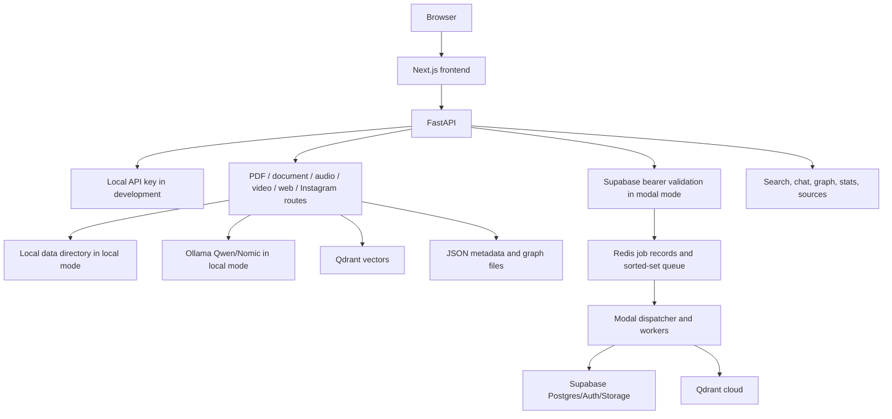

# MindMesh production audit and improvement roadmap

Audit date: 6 October 2026  
Scope: current checkout at `J:\Mindmesh by gitlab\mindmesh-main`, including the previous Modal implementation work and the pasted production-audit brief.

This document is an audit and planning artifact. It does not claim that the application, containers, Modal images, database migration, or deployment were executed successfully. The user explicitly requested that no tests be run during the earlier implementation work, so every item below that requires runtime evidence remains unverified until a separate validation phase.

## Executive assessment

MindMesh has a strong prototype feature set: Next.js UI, FastAPI routes, six ingestion families, Qdrant retrieval, RAG chat, graph extraction, file persistence, local Docker, and a proposed Modal worker layer. It is not yet safe to expose publicly as a multi-tenant SaaS.

Recommended current score: **42/100 for production readiness**.

The score reflects architecture and code intent, not successful operation. The largest risks are incomplete end-to-end verification, the size and complexity of the cloud change, unverified authentication and ownership enforcement across every route, JSON-backed domain state, an at-least-once job pipeline without a transactional outbox, missing CI/CD and operational evidence, and the fact that credentials were pasted into chat. Rotate those credentials before doing anything else.

The correct order is:

1. Freeze the public launch and rotate secrets.
2. Validate the current code and dependency/build assumptions in a disposable environment.
3. Close authentication, authorization, tenant isolation, storage, job, and backup gaps.
4. Establish observability, limits, incident recovery, and cost controls.
5. Run a private beta with measured load.
6. Only then open public registration or broad traffic.

## Current architecture reconstructed from the code

The current checkout includes a second, cloud-mode path. In cloud mode uploads are staged in private Supabase Storage, jobs are queued in Redis, model-heavy work is delegated to Modal, and tenant-scoped state is intended to use Supabase Postgres. Existing local routes and parsers remain in the tree for development compatibility. The implementation is therefore a dual-mode architecture rather than a fully proven cutover.

## Status of the previous implementation

Status meanings: **Done** means code/documentation was added in the previous work; **Partial** means a foundation exists but important integration or evidence is missing; **Not done** means no implementation was delivered or the requested outcome is still absent.

| Area from the previous work | Status | What exists | What remains |
|---|---|---|---|
| Modal application and deployment module | Partial | `workers/modal/app.py`, images, CPU/GPU functions and deploy command | Build/deploy has not been run; Modal API/image syntax and package inclusion need validation |
| Qwen3 worker | Partial | A10G class, warm model loading, remote client | Prompt quality, generation limits, cancellation, model availability, cost and output validation are unverified |
| BGE-M3 migration | Partial | 1,024-dimension target, new collection name, dimension/model checks, migration script | No reindex has run; existing vectors are not migrated; collection creation and payload-index behavior are unverified |
| Faster-Whisper worker | Partial | GPU worker, cloud storage staging, warm model | Audio duration/codec limits, cleanup failure handling, language policy and real transcription are unverified |
| Document/PDF worker | Partial | Docling/Tesseract image, PyMuPDF fallback, structured chunks | Docling artifact command and API compatibility are unverified; page/table/OCR quality is unmeasured |
| YouTube transcript-first flow | Done in code / unverified | Transcript API first, Whisper fallback retained | Need runtime tests, rate-limit handling, copyright/terms policy and download limits |
| Web/Crawl4AI/Playwright flow | Partial | Browser-first cloud behavior and URL guard | Browser hook compatibility, DNS rebinding defense, robots/terms policy and resource limits need validation |
| Instagram/Instaloader fallback | Partial | Existing Playwright-first and fallback code retained | Provider blocking, account policy, media size, credentials and legal/terms review remain |
| Redis job queue | Partial | Job envelope, idempotency key, lease, retries, cancellation and dispatcher | No durable outbox, dead-letter queue, queue metrics, reconciliation worker or runtime evidence |
| Supabase Auth integration | Partial | Bearer validation and sign-in UI | Refresh/session behavior, invite/reset flow, admin membership lifecycle and all-route coverage need validation |
| Multi-tenancy | Partial | Scope context, membership lookup, tenant-prefixed storage, Qdrant filters | Every endpoint/resource needs an authorization matrix and adversarial cross-tenant verification |
| Supabase metadata state | Partial | Tenant state adapter and SQL migration | JSON-in-JSON state is a beta compromise; normalized tables, indexes, constraints, RLS review and migrations remain |
| Supabase private file storage | Partial | Tenant keys, bounded reads, signed links | Upload quotas, antivirus/content validation, deletion reconciliation, lifecycle rules and signed-link audit remain |
| Qdrant isolation | Partial | Tenant filter intended for search/scroll/count/delete/upsert | Every query path and collection must be validated; old unscoped vectors need explicit migration or quarantine |
| Structured logging | Partial | Cloud allowlisted formatter and job fields | Central log sink, correlation IDs on every request, redaction review and alerts remain |
| Conversation history | Partial | User-scoped conversation persistence and frontend restore | Normalized conversation schema, retention/export/delete and concurrent-turn semantics need work |
| Frontend cloud auth and job polling | Partial | Auth gate, bearer headers, 202 polling, reconnect metadata | UX for expired sessions, upload progress, cancellation and failed/recovered jobs needs product polish |
| Rate limiting | Partial | Existing IP middleware; heavy-task cap; cloud upload semaphore | Must become distributed/user/tenant aware with endpoint classes, quotas and `Retry-After` behavior |
| Secrets and ignore rules | Partial | Templates avoid values; ignore rules expanded | Rotate exposed keys, use secret manager/CI OIDC, scan git history and remove any leaked credentials |
| Docker separation | Partial | Cloud API image and standalone compose | HTTPS proxy, non-root/runtime hardening, image scanning, pinned digests and deployment host are missing |
| Documentation | Done as documentation | Modal deployment and implementation reports were added | This audit adds the missing status/priority view; runbooks still need owner and tested procedures |
| Tests and deployment verification | Not done by instruction | No tests or deployment were run | Separate validation phase is mandatory before any beta |

## Production scorecard

Scores are current estimates based on code inspection and the previous change report. They are not test results.

| Area | Score | Assessment | Priority |
|---|---:|---|---|
| Architecture | 55 | Good separation of frontend/API/workers in design; dual-mode path is complex and unproven | P0 |
| Backend API | 52 | Broad route coverage and limits exist; route-level auth/data ownership is inconsistent | P0 |
| Frontend | 58 | Mature UI and source links; cloud auth/job failure states are new and unverified | P1 |
| Authentication | 45 | Supabase bearer path exists; lifecycle, refresh, invite and route coverage need evidence | P0 |
| Authorization | 35 | Central scope is promising; source, graph, notes, stats and legacy routes need a complete matrix | P0 |
| Multi-tenancy | 35 | Tenant fields/filtering are added; old data and every query path are not proven isolated | P0 |
| Database/Supabase | 30 | Migration exists; JSON state and service-role-heavy access are weak foundations | P0 |
| Qdrant | 50 | BGE-M3 separation and filters are designed; cloud collection migration is not complete | P0 |
| Redis/jobs | 45 | Lease/idempotency/retry foundation exists; no outbox/DLQ/reconciliation evidence | P0 |
| AI/ML | 50 | Intended models and warm loading are defined; quality, safety, cost and compatibility are unknown | P1 |
| RAG | 48 | Retrieval/citations/history exist; evaluation, prompt injection defense and grounding metrics are missing | P1 |
| GraphRAG | 38 | Graph extraction exists; JSON storage, duplicate/quality controls and tenant validation need work | P1 |
| Ingestion | 48 | Six source types and fallbacks exist; provider failures and quotas are not operationally managed | P1 |
| File processing | 50 | Format and zip-bomb checks exist; malicious media/resource exhaustion needs stronger isolation | P0 |
| Storage | 42 | Private cloud path exists; retention, lifecycle, malware scanning and reconciliation are missing | P0 |
| Security | 34 | SSRF, API limits and secret separation were considered; public threat model and scans are absent | P0 |
| Performance | 35 | Batch embeddings and warm models help; no baseline, profiling or backpressure evidence | P1 |
| Scalability | 38 | Modal can scale workers; API/database/Qdrant/Redis capacity is unknown | P1 |
| Reliability | 38 | Retry and lease ideas exist; distributed consistency and recovery are incomplete | P0 |
| Observability | 30 | Structured fields exist; no metrics, tracing, alerting, SLOs or dashboards | P1 |
| Logging | 45 | Cloud formatter suppresses sensitive content; centralized retention/search is absent | P1 |
| Error handling | 50 | Public error shaping and retry classes exist; consistency across all routes needs review | P1 |
| Testing readiness | 20 | Tests exist in repository but were not run and cloud paths lack coverage | P0 |
| DevOps/Docker | 40 | Local and cloud Docker paths exist; hardened release pipeline is absent | P1 |
| CI/CD | 10 | No production CI/CD workflow was added | P1 |
| Secrets management | 42 | Modal secret template exists; exposed credential rotation and automated scanning are pending | P0 |
| Cost control | 35 | Scale-to-zero and bounded workers are planned; budgets and per-tenant quotas are absent | P1 |
| Deployment readiness | 30 | Commands are documented; no successful build, migration or deploy evidence | P0 |
| Documentation | 65 | Architecture/deployment reports are detailed; tested runbooks and ownership are missing | P2 |

## Production blockers

### P0 — must close before public deployment

1. Rotate the Supabase service-role key and every credential exposed in chat, `.env` files, shell history, CI logs or old commits. Run secret scanning against the full git history.
2. Do not launch until the Modal images, API image, frontend build, SQL migration and worker deployment are successfully built and manually reviewed in a disposable environment.
3. Produce an authorization matrix for every route and resource: source, download, view, delete, notes, stats, timeline, graph, search, chat, compare, jobs and conversations. Deny by default.
4. Prove that a user cannot read, search, delete or infer another tenant's database rows, Qdrant points, graph edges, storage objects, job records, conversation turns or error details.
5. Move production source/graph/conversation data from JSON blobs to normalized Postgres tables with primary keys, foreign keys, tenant indexes, timestamps, soft-delete policy and uniqueness constraints. Keep JSON only for bounded metadata fields.
6. Decide whether a tenant is a shared workspace or a private user account. Encode that policy explicitly; the current beta model shares sources within a tenant but restricts conversations/jobs by user.
7. Make every Qdrant collection tenant-aware and model-aware. Quarantine or explicitly migrate legacy unscoped Nomic vectors; never silently combine 768-dimension Nomic with 1,024-dimension BGE-M3.
8. Add a durable outbox or equivalent transaction boundary so a committed database job cannot disappear before Redis sees it. Add a dead-letter queue, reconciliation loop, stuck-job repair and operator replay procedure.
9. Replace IP-only rate limiting with distributed limits keyed by user, tenant, IP and endpoint class. Add upload bytes/day, source count, job concurrency, token, storage and GPU budget limits.
10. Enforce secure file handling: MIME/signature validation, decompression and page/time limits, malware scanning, media duration limits, archive quotas, private object policy, lifecycle cleanup and deletion reconciliation.
11. Establish backups and recovery targets for Supabase/Postgres, Qdrant, Redis job state, Storage, and model/configuration metadata. Perform a restore drill before launch.
12. Add central metrics, traces, audit events and alerts for authentication failures, cross-tenant denials, queue age, retries, Modal cold starts, GPU time, storage growth, Qdrant latency, database errors and provider failures.
13. Define SLOs and an incident process: availability, job completion latency, error budget, severity levels, on-call ownership, escalation, communication and postmortem template.
14. Validate SSRF and browser isolation with an egress policy. Application DNS checks are not enough for a public crawler. Block metadata IPs, private ranges, unsafe redirects, excessive subresources and uncontrolled downloads.
15. Add request authentication to every cloud route and remove or disable legacy route paths that bypass the cloud job facade. Confirm middleware ordering and WebSocket/SSE behavior.

### P1 — must close before serious beta

1. Add CI for formatting, type checks, dependency vulnerability scan, secret scan, unit tests, API contract tests, frontend build and container build. Add protected branch review.
2. Pin dependencies with lockfiles and image digests. Produce an SBOM and scan images before release.
3. Add model evaluation sets for retrieval recall, citation correctness, hallucination rate, multilingual queries, OCR, transcription and summary quality. Track regressions per model version.
4. Defend RAG against prompt injection in retrieved text; separate instructions from source content, bound context, label untrusted text and avoid executing model-produced actions.
5. Add per-provider circuit breakers, timeouts, backoff with jitter, concurrency caps and graceful degradation. Handle YouTube, Instagram, Crawl4AI, Qdrant, Supabase and Modal outages separately.
6. Add job progress events, resumable uploads, user-visible queue position/ETA, stale-job repair and clear retry/cancel semantics.
7. Add database pagination and search indexes; avoid loading all sources/graph nodes into memory. Cap graph size per tenant and normalize graph entities/edges.
8. Add retention, export, account deletion and tenant deletion workflows with an auditable cascade across Postgres, Qdrant, Storage, Redis and Modal scratch data.
9. Add CSRF/cookie policy if browser cookies are introduced, secure headers, CSP, HSTS, trusted proxy handling, request IDs and strict CORS allowlists.
10. Establish provider and content policies: copyright boundaries for YouTube, Instagram terms, robots behavior, user consent for uploads, prohibited content and abuse reporting.
11. Add health/readiness separation. Liveness should be cheap; readiness should reflect required dependencies without leaking URLs or credentials.
12. Add cost dashboards and hard quotas. Estimate cost per source type, per minute of audio, per PDF page, per embedding batch, per chat request and per tenant.
13. Add frontend accessibility, keyboard navigation, mobile layout, error recovery, offline/refresh behavior and safe handling of expired sessions.
14. Add admin tooling for tenant membership, quota overrides, job replay, source deletion, audit review and incident response. Protect it with separate roles and MFA.

### P2 — before broad growth

1. Normalize source/resource tables and add full-text search where useful.
2. Add semantic caching only for explicitly public or tenant-scoped content; never share private answer/context caches across tenants.
3. Add provider-independent ingestion adapters and a clear plugin boundary.
4. Add model version metadata to every source/chunk/result and a re-embedding/re-summarization scheduler.
5. Add data residency and encryption-key decisions.
6. Add product analytics that exclude private document content and are consent-aware.
7. Add collaboration features only after workspace roles, invitations and audit trails are stable.
8. Add scheduled backups, archival tiers, storage lifecycle policies and user-visible usage history.

### P3 — polish

1. Improve empty states, source previews, citation navigation and bulk actions.
2. Add keyboard shortcuts, command palette coverage and richer notifications.
3. Add import/export formats and duplicate-source explanations.
4. Add localization, timezone consistency and improved error copy.
5. Add optional streaming token delivery after durable job completion is correct.

## Feature and functionality audit

| Functionality | Current assessment | Required improvement |
|---|---|---|
| YouTube | Transcript-first logic exists | Handle unavailable captions, provider rate limits, download limits, copyright notice, language selection and durable progress |
| Web | httpx/Crawl4AI/Playwright paths exist | Add robots/terms policy, crawl budget, canonical URL deduplication, content hash, extraction quality metrics and egress controls |
| Instagram | Playwright/Instaloader/OCR/speech path exists | Treat provider blocking as expected, add account consent, media quotas, retry classes and clear failure UX |
| PDF | Docling/PyMuPDF/OCR structure exists | Enforce page/render/time quotas, malicious PDF isolation, table fidelity metrics and page-level citation metadata |
| Documents | DOCX/PPTX/XLSX/CSV/TXT/Markdown parsers exist | Add macro/embedded-object policy, archive quotas, encoding detection, duplicate detection and structured metadata |
| Audio | Faster-Whisper path exists | Duration/file limits, language/diarization policy, progress, noisy audio handling, transcription confidence and cost quotas |
| RAG chat | Citations/history/source filters exist | Retrieval evaluation, prompt injection defense, grounding checks, answer feedback, token budgets and conversation retention |
| Search | Semantic search and source metadata exist | Tenant/ACL filtering tests, hybrid search, pagination, relevance tuning, query abuse limits and explainable scores |
| Graph | Relation extraction and visualization exist | Normalize graph tables, tenant ACLs, provenance per edge, confidence, deduplication, graph query limits and rebuild jobs |
| Notes | Local/store operations exist | Postgres ownership, versioning, conflict handling, soft deletion, export and audit history |
| Sources | Browse/download/delete exists | Transactional cascade, signed links, access audit, deletion retry and per-tenant pagination |
| Dashboard/stats | Real counts/storage fields are wired | Avoid expensive scans, cache safely, add query latency and operational metrics |
| Notifications | Frontend notification system exists | Durable server events, unread synchronization, retry/failure notices and tenant-safe delivery |
| Settings | Local API key/theme/settings exist | Separate user/workspace settings, server-side validation and remove API key UX in cloud mode |

## Rate limiting and abuse control design

Use Redis-backed token buckets or sliding windows. Enforce the strictest applicable limit:

| Class | Suggested initial beta policy |
|---|---|
| Anonymous/public | No ingestion or search; only landing/contact endpoints with a low IP limit |
| Authenticated reads | 120 requests/minute/user, 600/minute/tenant, with endpoint-specific caps |
| Chat/search | 30 requests/minute/user; token/context budget per request and daily token quota |
| URL ingestion | 10 jobs/hour/user, 50/hour/tenant, URL deduplication and provider backoff |
| File ingestion | 5 concurrent jobs/user, 20/tenant; bytes/day and file-size limits |
| Audio/video | Duration/day quota and maximum duration; separate GPU budget |
| Storage | Per-tenant bytes and object count; reject before upload when quota is exceeded |
| Job polling/SSE | 30 polls/minute/job and one active stream/client; use `Retry-After` |
| Admin operations | Separate role, MFA, lower concurrency and full audit event |

Return `429` with `Retry-After`, a stable error code and a request ID. Rate-limit by authenticated identity in addition to IP; IP alone fails behind NAT and does not stop one user distributing requests across addresses. Add concurrency semaphores around parsing, browser sessions, OCR, GPU calls and database connections. Monitor rejected requests and automatically increase restrictions during abuse.

## Recommended implementation phases

### Phase 0 — evidence and containment

Rotate leaked credentials, freeze public launch, inventory environments, scan git history, create a disposable staging project, and record current dependency/runtime versions. Produce a data-flow and authorization matrix before further feature work.

### Phase 1 — security and ownership

Finish Supabase Auth/session lifecycle, membership roles, route authorization, tenant-aware Postgres tables, Storage policy, Qdrant filters, job ownership, secure headers, CORS, SSRF/browser egress and secret management.

### Phase 2 — reliable data and jobs

Move JSON state to normalized Postgres, implement an outbox/reconciler/DLQ, repair stuck jobs, make deletion/export/account removal consistent, and add idempotency around every side effect.

### Phase 3 — production AI workers

Build and run Modal images, validate model loading/caching, benchmark Qwen/BGE/Whisper/Docling, migrate a small labeled corpus to the new BGE collection, and establish GPU/CPU quotas and cost budgets.

### Phase 4 — observability and validation

Add OpenTelemetry/metrics/log aggregation, dashboards, alerts, SLOs, dependency health, backups, restore drills, security scans, API contract tests, load tests and tenant-isolation tests.

### Phase 5 — private beta

Invite a small number of users, cap quotas, inspect every job failure, measure latency/cost/quality, run incident exercises, and fix the top failure modes before expanding access.

### Phase 6 — public readiness

Complete legal/content policies, billing or quota enforcement, support/abuse workflows, disaster recovery evidence, release gates and a rollback plan. Only then enable public registration.

## Definition of production-ready

MindMesh should not be called production-ready until all of the following are demonstrated in staging or production-like infrastructure:

- A new user can authenticate, receive exactly the intended workspace access, and lose it immediately when membership is revoked.
- Two tenants cannot read, search, delete, infer or download one another's data through any API, job, vector, graph, file, cache or error path.
- Every long-running job survives API restarts, retries safely, reaches a terminal state, is observable, and can be reconciled or replayed by an operator.
- Restore drills recover Postgres, Storage, Qdrant configuration/data and job state within documented RPO/RTO targets.
- Modal images build reproducibly, workers load models once, quotas hold, provider failures degrade safely, and cost per workload is known.
- Security scans, dependency scans, authorization tests, tenant-isolation tests, load tests and representative AI-quality evaluations pass agreed gates.
- Users can export/delete their data, see failures without secrets or stack traces, and understand queue, quota and retention behavior.

## Final verdict

The previous work delivered a substantial cloud architecture foundation and documentation. It did not complete the production conversion. The remaining work is primarily proof, security hardening, normalized data design, operational reliability, cost control and product policy. Treat the previous Modal code as an implementation candidate awaiting validation, not as a deployed or production-certified system.

No tests, builds, migrations or deployments were run for this audit.
